# kaiHEN Installer

A no-install GUI — for **Windows and Android** — that sets up **kaiHEN**, the homebrew enabler by [ouncebrew](https://github.com/ouncebrew), on a Nintendo Switch 2, using **Civilization VII (Switch 1 version, v1.0.0)** as the entry point.

Switch 2 (ファームウェア **23.0.1 ちょうど**) で、シヴィライゼーション7(Switch 1 版 v1.0.0) を入口にして **kaiHEN** を導入するための、インストール不要の GUI です。

**Windows 版と Android 版**があります。

> [!WARNING]
> The console firmware must be **exactly 23.0.1**.
>
> Never accept a system update: newer firmware both overshoots the target and patches the exploit.
>
> kaiHEN is work-in-progress software that grants homebrew full access (including NAND); a malicious homebrew could brick the console.
>
> Use at your own risk.
>
> 本体のファームウェアは **23.0.1 ちょうど**である必要があります。
>
> 本体の更新は絶対にしないでください。
>
> kaiHEN は開発途中のソフトで、自作ソフトにNAND を含む全権限を与えるため、悪意のある自作ソフトを実行すると本体が起動しなくなる恐れがあります。
>
> すべて自己責任で使用してください。

> [!CAUTION]
> **Android version: starting kaiHEN from the phone has not been tested yet.**
>
> The GUI, downloads and homebrew installation from the Android app are verified on real hardware, but the kaiHEN launch itself (the phone runs the launch engine internally) is still unconfirmed.
>
> If it does not work, use the Windows version to start kaiHEN.
>
> **Android 版について: スマホからの kaiHEN 起動はまだ試せていません。**
>
> Android 版の画面表示、ダウンロード、自作ソフトのインストールは実機で確認済みですが、kaiHEN の起動そのもの (スマホ内部で起動エンジンが動きます) は未確認です。
>
> うまくいかない場合は Windows 版で kaiHEN を起動してください。

## What it does / できること

- **Installs kaiHEN in a few clicks** — install the loader save, then start kaiHEN with the bundled CivSwitch Kit engine (retries are automatic).

  kaiHEN is pinned to **20261117.1** and used **exactly as published** —no file is modified (its hbmenu carries the official fix for the textInit 2345-0011 error).

  **数クリックで kaiHEN を導入** — ローダーのセーブを入れて、同梱のCivSwitch Kit エンジンで kaiHEN を起動します (リトライは自動)。

  kaiHEN は **20261117.1** に固定し、**公開ファイルに一切手を加えず**そのまま使います (hbmenu には textInit 2345-0011 エラーの公式修正が含まれます)。
- **Autoloader** — after a one-time setup, kaiHEN starts from **Load Game** alone: no PC, no phone, no Pico, no network.

  Includes the CivSwitchFS payload (stock-20261125b) from the companion fork.

  The SD files follow upstream civ-autoloader, whose bundled hbmenu is now also the officially fixed kaiHEN 20261116 build.

  **オートローダー** — 初回だけ設定すれば、あとは**ゲームをロード**するだけで kaiHEN が起動します (PC・スマホ・Pico・ネットワーク不要)。

  CivSwitchFS のペイロード (stock-20261125b) を同梱。

  SD ファイルは上流 civ-autoloader に追随し、同梱 hbmenu も公式修正済みの kaiHEN20261116 版になりました。
- **Homebrew catalog** — install compatible homebrew to the console over FTP (OunceShell), or send your own `.nro` files and folders.

  The newest release of each app is fetched automatically; if a release ships no files, the newest release that does is used.

  **自作ソフトのカタログ** — 対応ソフトを FTP (OunceShell) で本体にインストールできます。

  自分の `.nro` ファイルやフォルダを送ることもできます。

  各ソフトは最新リリースを自動で取得します (ファイルの無いリリースしか無い場合は、ファイルのある一番新しいリリースを使います)。
- **Gallery** — an NXGallery-style album view over FTP (OunceShell or the FTPD plugin): the SD card album as a thumbnail grid; tap an item to view it full-size or play the video, see its details, and download it.

  You can also check multiple items and download them together as one zip file.

  Each item in the grid also has its own download button.

  Captures in internal storage are not reachable over FTP, so only the SD card album is shown.

  There is intentionally no delete: removing an album file over FTP leaves an entry in the console's album that cannot be deleted even on the console itself (its screenshot service fails with error 2206-0023 when the file is missing).

  **ギャラリー** — FTP (OunceShell または FTPD プラグイン) 経由でNXGallery 風にアルバムを表示します。

  SD カードのアルバムをサムネイル一覧で表示し、タップで拡大表示・動画再生・詳細表示・ダウンロードができます。

  複数にチェックを入れて、まとめて ZIP でダウンロードもできます。

  一覧の1件ずつにもダウンロードボタンがあります。

  内部ストレージのキャプチャは FTP では見られないため、SD カードのアルバムだけが対象です。

  削除機能はあえて付けていません。

  FTP でファイルを消すと本体のアルバムに項目だけが残り、その項目は本体側でも消せなくなるためです (ファイルが無いと本体の画面写真サービスがエラー 2206-0023 を出します)。
- **Self-update** — the app checks this repository's releases at startup.

  On Windows it replaces itself and restarts (your settings and downloaded files are kept).

  On Android it downloads the new APK and opens the phone's standard installer.

  **自動更新** — 起動時にこのリポジトリの最新リリースを確認します。

  Windows ではプログラムを入れ替えて自動で再起動します (設定やダウンロード済みのファイルは保持)。

  Android では新しい APK をダウンロードして、スマホ標準のインストール画面を開きます。
- **Network safety helpers** — 90DNS guidance, SWFence router isolation, and an Offline WAN Emulator installer for Raspberry Pi.

  **ネットワークの安全策** — 90DNS の案内、SWFence によるルーター隔離、Raspberry Pi 用 Offline WAN Emulator の導入機能。
- **Pico UF2 included** — ipfix3 loader firmware for Pico 1 / Pico 2, JIS (Japanese) and US layouts.

  **Pico 用 UF2 同梱** — ipfix3 ローダーのファームウェアです(Pico 1 / Pico 2 用、JIS・US 配列)。
- **12 languages** — 日本語 / English / Français / Deutsch / Italiano / Español / Русский / Português / Polski / 한국어 / 简体中文 / 繁體中文.

  **12言語対応**です。

## Homebrew catalog / 自作ソフトカタログ

32 apps, installed over FTP into `/switch` (or their own folders where the release requires it):

90DNS Tester / Blacklist Tool / BrewStore / Cemu NX2 / Checkpoint / Chiaki-ng/Akira / Chromium NX / Dekopon for SW2 / Dolphin NX2 / Eden for SW2 (POC) / Force Internal Speaker / FTPD Plugin / Game Vault / KaiDump / KaiPlayer / KaiRadio / KaiVideo / Kaizhar / mGBA / Moonlight / Moonlight-Switch / NXGallery / OunceMTP / PKSM / PPSSPP NX2 / RetroArch / SW2NES / SW2PS2 / SW2SNES / SW2Transfer / Vita3K / WinampNX2

32本のソフトを、FTP で `/switch` (リリースの指定するフォルダ) にインストールできます。

## Download / ダウンロード

Get the files from the [Releases](https://github.com/yyoossk/kaihen-installer/releases) page.

Releases ページからダウンロードしてください。

### Windows

Download `kaiHEN Installer.zip`, unzip, and run `kaiHEN Installer.exe`.

No installation, and no Python or Node is required.

`kaiHEN Installer.zip` をダウンロードして展開し、`kaiHEN Installer.exe`を実行するだけです。

Python や Node のインストールは不要です。

### Android

Download `kaiHEN-Installer-Android.apk` (Android 8.0 or later) and open it to install (sideload).

The Android app has the same screens and features as the Windows version, plus a dark theme.

Large files are not bundled: kaiHEN and homebrew are downloaded when you use them, exactly like on Windows.

`kaiHEN-Installer-Android.apk` (Android 8.0 以上) をダウンロードして開くとインストールできます (サイドロード)。

画面と機能は Windows 版と同じで、ダークテーマもあります。

大きなファイルは同梱されておらず、kaiHEN や自作ソフトは Windows 版と同じく使うときにダウンロードします。

## Screen guide / 画面紹介

Desktop screenshots are from build 20261117-0327, Japanese (left) and English (right) side by side.

Android screenshots are from build 20261117-2112.

PC 版のスクリーンショットは build 20261117-0327 のもので、日本語 (左)と英語 (右) を横並びにしています。

Android 版は build 20261117-2112 のものです。

### 1. Home / ホーム

The top page.

Pick what you want to do: install kaiHEN, set up the autoloader, or install homebrew.

The build stamp at the top identifies the version (hidden in the Android app).

トップページです。

「kaiHEN を導入」「オートローダー」「自作ソフトをインストール」から選びます。

上部の表示がバージョン (build) です(Android 版では非表示)。

| 日本語 | English |
| --- | --- |
| 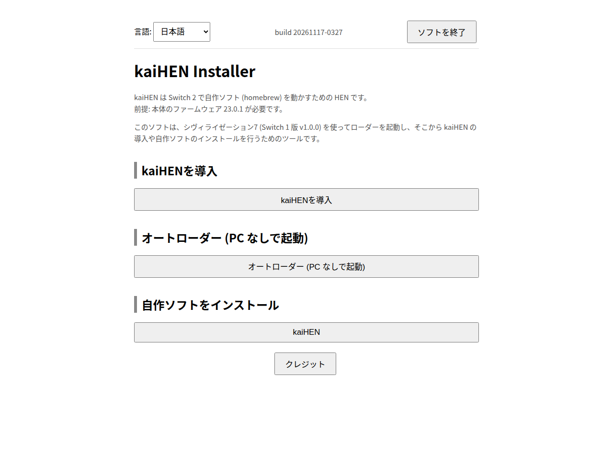 | 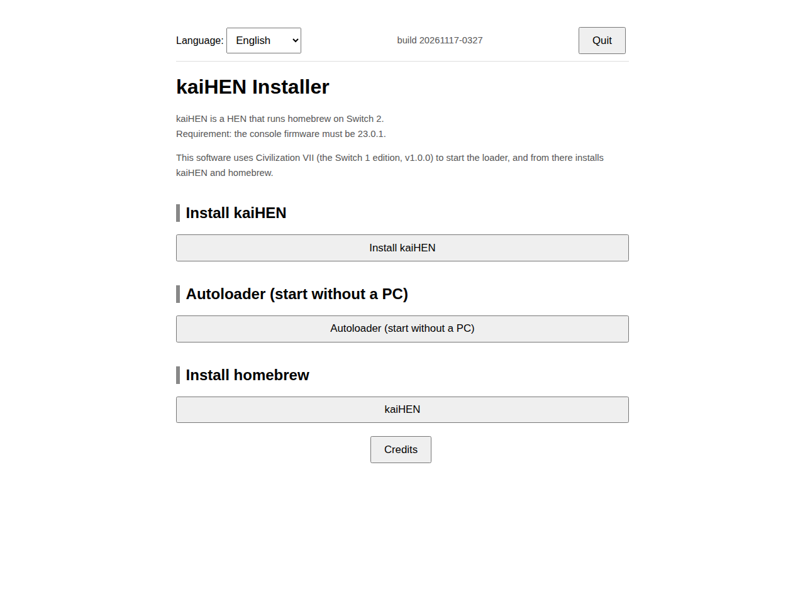 |

### 2. Install kaiHEN / kaiHEN を導入

The main page, in order: the first-time steps (flash the Pico UF2), the console network settings (90DNS), the in-game autosave setting, the router isolation tools, the connection check, and the two big buttons —**install the loader save**, then **start kaiHEN**.

An optional auto-start watches for the loader and runs everything by itself.

Results are shown in a dialog, and failures say why.

中心のページです。

初回手順 (Pico への UF2 書き込み)、本体のネットワーク設定 (90DNS)、ゲーム内のオートセーブ設定、ルーター隔離ツール、接続確認、そして「ローダーのセーブを入れる」→「kaiHEN を起動」の順に進めます。

自動起動をオンにすると、ローダーを検知して全部自動で実行します。

結果はダイアログで表示され、失敗時は理由も出ます。

| 日本語 | English |
| --- | --- |
| 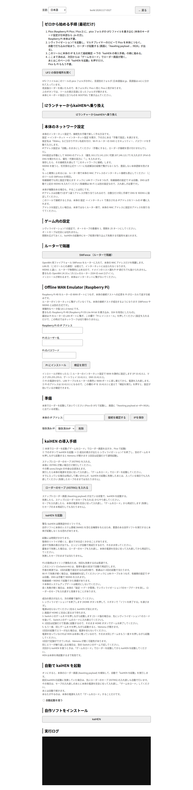 | 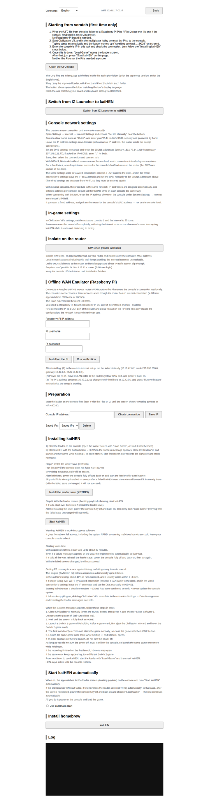 |

### 3. Autoloader / オートローダー

Sets up the autoloader save.

After this one-time setup, starting kaiHEN is just **Load Game** on the console — the save runs everything by itself.

The page explains what each on-screen message means and what to do when a run fails.

The current payload is stock-20261125b: the stock upstream payload plus three small fixes.

オートローダーのセーブを入れるページです。

初回だけ設定すれば、あとは本体で「ゲームをロード」するだけで kaiHEN が起動します (PC・スマホ・Pico・ネットワーク不要)。

画面に出る文言ごとの意味と、失敗したときの対処も書いてあります。

現在のペイロードは stock-20261125b です。
純正ペイロードに小さな修正を3点足したものです。

The autoloader's payload comes from [yyoossk/CivSwitchFS](https://github.com/yyoossk/CivSwitchFS).

The fork's improvements over upstream are:
- **Timing learning** — the winning timing is recorded in the save and reused from the next boot.
- **Freeze fix** — IPC sends have a 10-second timeout, so an unresponsive run stops safely with a message instead of hanging.
- **Retirement precheck** — the candidate cache is read back first, and the retirement waves are skipped when the alias is already gone.

More failures can be retried safely within the same boot.
- **Cleanup cache invalidate** — the dirty scratch file's cache is invalidated before the scratch tree is deleted and committed.
- **Retune threshold** — in-run timing adjustments engage unless at least 80% of windows qualify (previously 50%).
- **OperateRange packet size** — the cache-invalidate commands declare the correct 0x0E words, matching the reference implementation.
- **Dirty file 7 MiB** — reduced from 8 MiB, leaving 1 MiB of headroom under the save-data cap.
- **Installer creates the save folders** — if the console's save data has no saves/Single folder, the autoloader-save installer creates it first instead of failing with `create : 0x202`.

See the [CivSwitchFS releases](https://github.com/yyoossk/CivSwitchFS/releases) for details.

The installer installs stock-20261125b.

That is the stock upstream payload plus three fixes: the OperateRange packet size, the dirty file at 7 MiB, and the installer's save-folder creation.

On the test console, every improved payload stopped at the first step of every boot, and this one booted on the first try.

The fork's earlier improvements (timing learning, the freeze fix, and the retry changes) are not in the current bootstrap.

Which of them breaks the first step is still under investigation.

オートローダーのペイロードは [yyoossk/CivSwitchFS](https://github.com/yyoossk/CivSwitchFS) のものです。

そのフォークの upstream からの改良点は次のとおりです。
- **タイミング学習** — 成功したタイミングをセーブに記録し、次回から再利用します。
- **フリーズ修正** — IPC 送信に10秒のタイムアウトがあり、無応答でも固まらずにメッセージを出して安全に止まります。
- **リタイア前チェック** — 候補キャッシュを先に読み戻し、エイリアスが既に消えていればリタイア用ウェーブを省略します。

同一ブート内で安全に再試行できる幅が広がります。
- **クリーンアップ時のキャッシュ無効化** — スクラッチを削除してコミットする前に、汚れたスクラッチファイルのキャッシュを無効化します。
- **再調整のしきい値** — 合格率80%未満でタイミング再調整が働きます (従来は50%未満)。
- **OperateRange のパケットサイズ** — キャッシュ無効化の命令が、参照実装と一致する正しい 0x0E 語を宣言します。
- **ダーティファイル 7MiB** — 8MiB から縮小し、セーブデータ上限に対して 1MiB の余裕を残します。
- **インストーラーがセーブフォルダを作成** — 本体のセーブデータに saves/Single フォルダが無い場合も、インストーラーが先に作るため「create : 0x202」で失敗しません。

詳しくは [CivSwitchFS のリリース](https://github.com/yyoossk/CivSwitchFS/releases) を見てください。

インストーラーが入れるのは stock-20261125b です。

純正の upstream ペイロードに、修正を3点 (OperateRange のパケットサイズ、ダーティファイル 7MiB、インストーラーのセーブフォルダ作成) 足したものです。

テスト機では、改良版ペイロードが毎回起動の最初の段階で止まる中、これだけが一発で起動しました。

フォークの従来の改良 (タイミング学習、フリーズ修正、リトライ変更) は現在のブートストラップには入っていません。

そのどれが最初の段階を止めているかは調査中です。

| 日本語 | English |
| --- | --- |
| 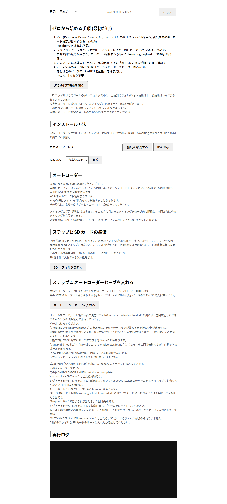 | 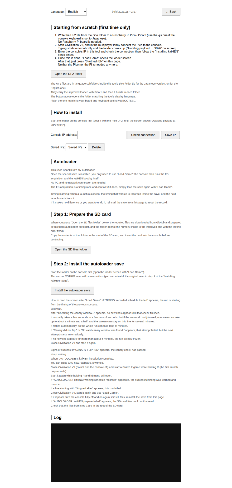 |

### 4. Install homebrew / 自作ソフトをインストール

Two ways to put homebrew on the console: pick from the catalog list —the app downloads the latest release and sends it to the console over FTP (OunceShell) — or send your own `.nro` files and folders (drag & drop on Windows).

The page's connection check also reports whether OunceShell's FTP server is answering.

自作ソフトを本体に入れるページです。

カタログの一覧から選ぶと、最新版をダウンロードして FTP (OunceShell) で本体へ送ります。

自分の `.nro`ファイルやフォルダを送ることもできます (Windows 版はドラッグ&ドロップ可)。

接続確認では OunceShell の FTP の応答も表示します。

| 日本語 | English |
| --- | --- |
| 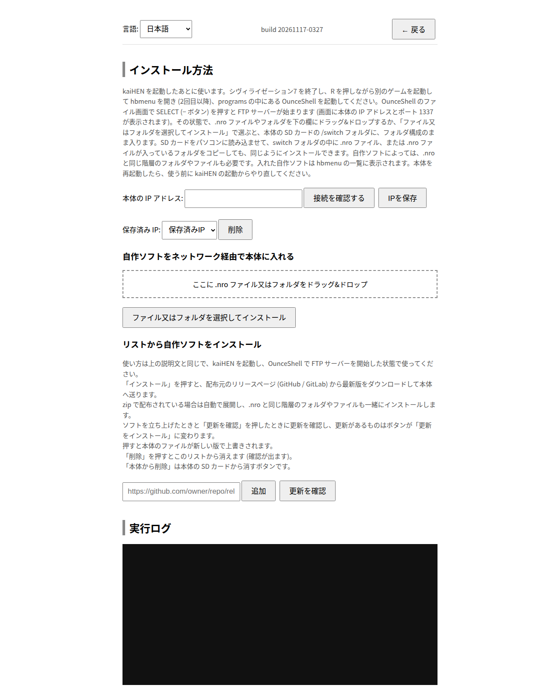 | 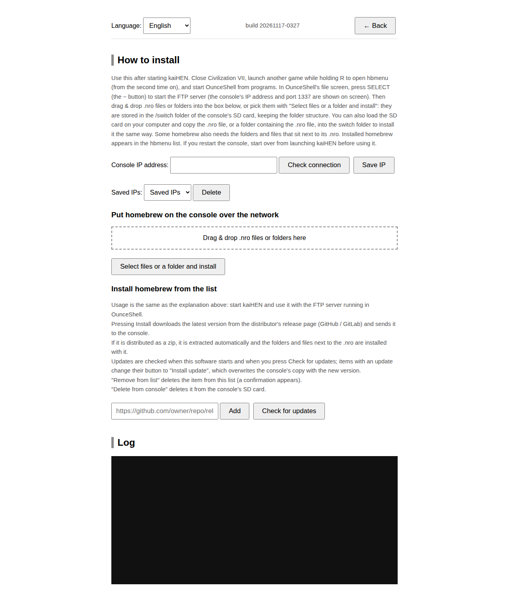 |

### 5. Switch from the IZ launcher / IZランチャーから乗り換え

For consoles that used the older IZ launcher: this page replaces the loader save with the plain one and starts kaiHEN, all on one page.

以前 IZ ランチャーを使っていた本体向けのページです。

ローダーのセーブを素の状態に入れ直して kaiHEN を起動するところまで、このページだけで完結します。

| 日本語 | English |
| --- | --- |
| 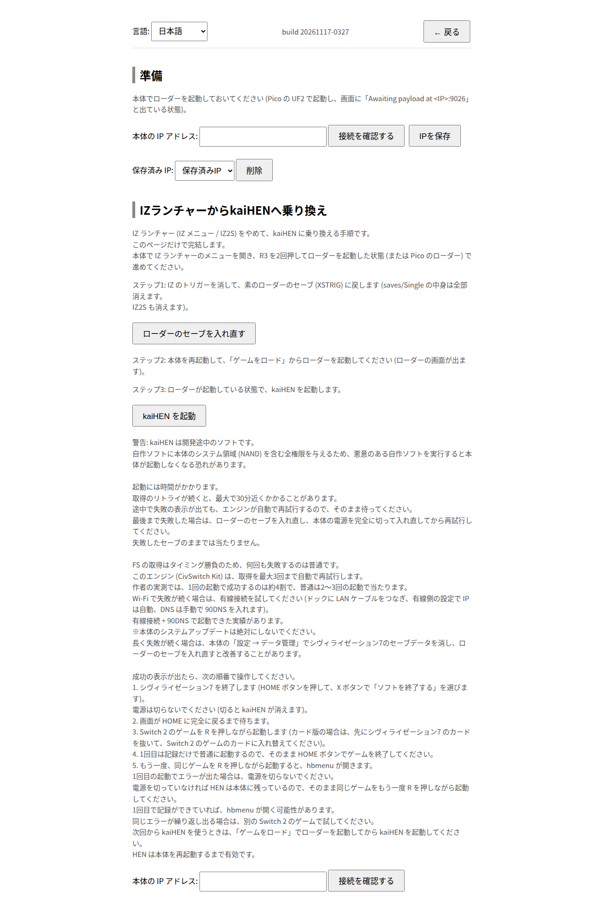 | 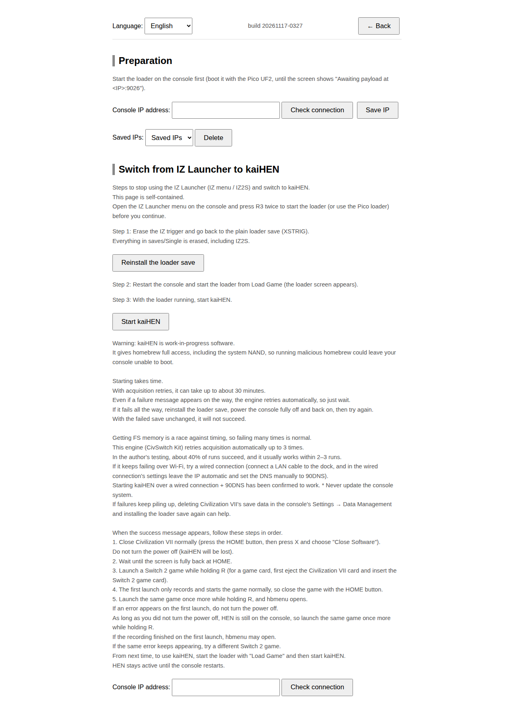 |

### 6. SWFence (router isolation) / SWFence (ルーターで隔離)

Installs SWFence on an OpenWrt router so the console can talk to your LAN (this tool) but never to the internet — stronger than DNS-based blocking.

OpenWrt ルーターに SWFence を入れ、本体を LAN 内だけに隔離するページです。

DNS で止める方式より確実にインターネットを遮断できます。

| 日本語 | English |
| --- | --- |
| 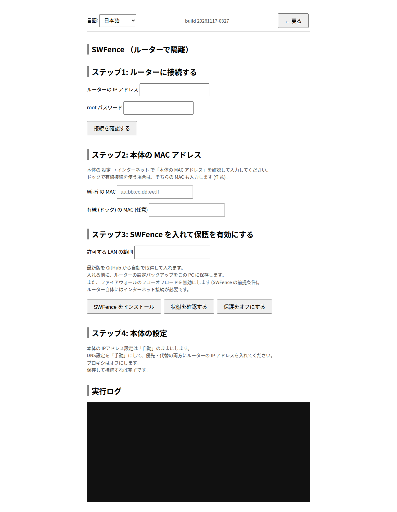 | 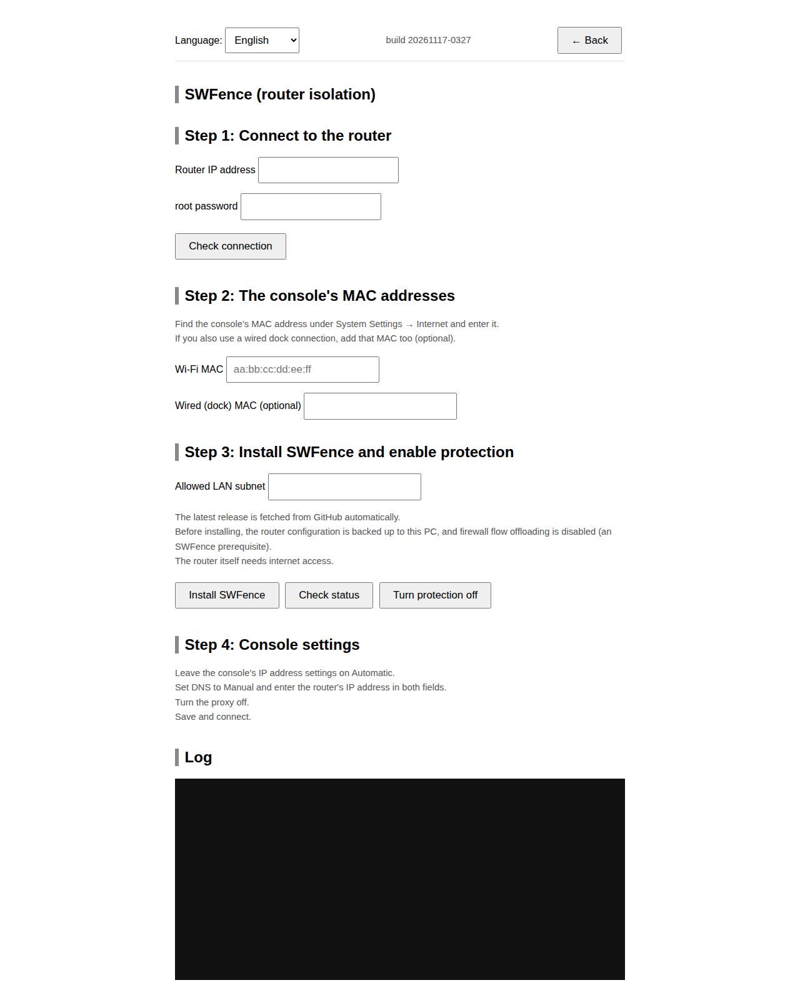 |

### 7. Android app / Android 版

The same screens on the phone.

Left: the home page (light theme).

Right: the homebrew page in the dark theme.

The language and theme selectors sit in one row, and the app follows the phone's language on first launch.

スマホでも同じ画面です。

左はホーム (ライトテーマ)、右はダークテーマの自作ソフトのページです。

言語とテーマの選択は横並びで、初回起動時はスマホの言語に合わせます。

| 日本語 | English |
| --- | --- |
| 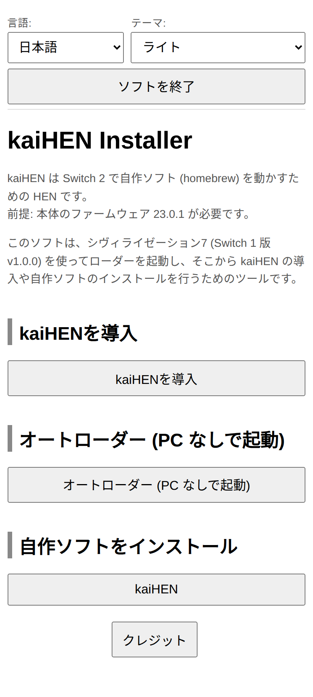 | 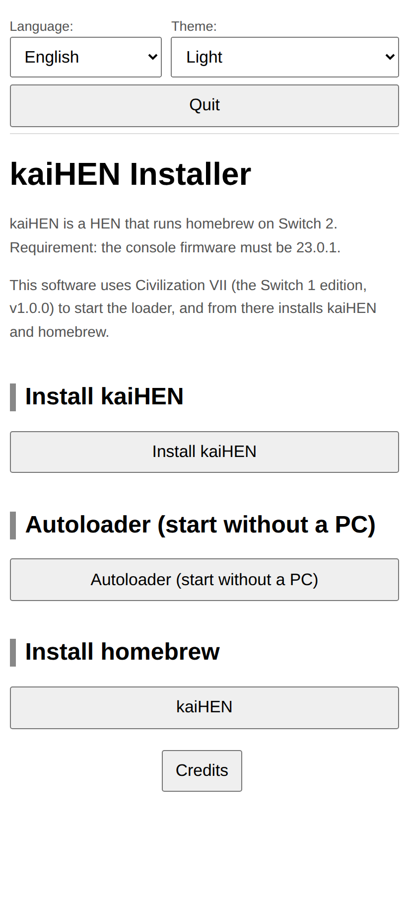 |
| 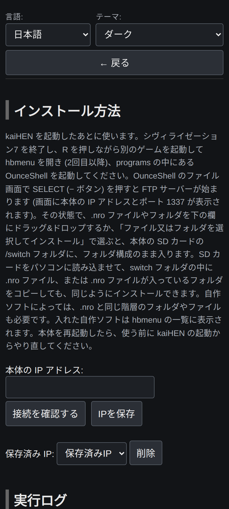 | 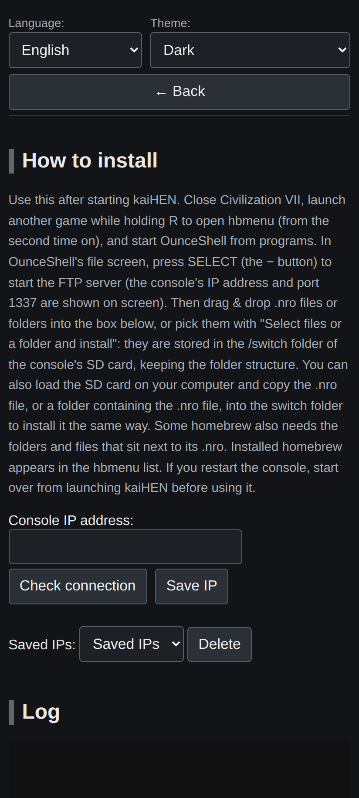 |

## Updates / 更新

See [CHANGELOG.md](CHANGELOG.md) for the full update history.

変更履歴は [CHANGELOG.md](CHANGELOG.md) をご覧ください。

At startup the app checks the latest release of this repository.

If a newer build exists, a dialog offers the update:

- **Windows** — the new zip is downloaded, the program and its bundled files are replaced, and the app restarts by itself.

  Files you created (settings, downloaded homebrew, the kaiHEN folder, staged SD files) are **not** deleted.

  The previous program is kept as `kaiHEN Installer.exe.old` until the next launch, so you can undo an update by renaming it back.
- **Android** — the new APK is downloaded inside the app; when the download finishes, the phone's standard install screen opens and you install it there.

  App data is kept, as with any APK update.

起動時に、このリポジトリの最新リリースを確認します。

新しい版があるとダイアログが出ます。

- **Windows** — 新しい zip をダウンロードしてプログラムと同梱ファイルを入れ替え、自動で再起動します。

  設定やダウンロード済みのファイル(自作ソフト、kaiHEN フォルダ、用意した SD ファイル) は**消えません**。

  前のプログラムは次回起動まで `kaiHEN Installer.exe.old` として残るので、名前を戻せば更新を取り消せます。
- **Android** — 新しい APK をアプリ内でダウンロードし、完了するとスマホ標準のインストール画面が開くので、そこでインストールします。

  アプリのデータは通常の APK 更新と同じく保持されます。

## Requirements / 前提

- Nintendo Switch 2 on firmware **exactly 23.0.1** (never update)
- Civilization VII **Switch 1 version, cartridge v1.0.0** (no game updates)
- A Windows PC, or an Android phone (8.0+), on the same network as the console
- For the first setup: a Raspberry Pi Pico or Pico 2 (not needed afterwards when using the autoloader)
- Recommended: wired LAN (dock) + 90DNS on the console

- Nintendo Switch 2、本体のファームウェアは **23.0.1 ちょうど** (更新禁止)
- シヴィライゼーション7 **Switch 1 版、カード v1.0.0** (ゲームの更新なし)
- 本体と同じネットワークにある Windows PC、または Android スマホ (8.0 以上)
- 初回設定用に Raspberry Pi Pico / Pico 2 (オートローダー使用後は不要)
- 推奨: 有線 LAN (ドック) + 本体に 90DNS

## Build from source / ビルド

```sh
GOOS=windows GOARCH=amd64 CGO_ENABLED=0 go build \
  -ldflags "-H=windowsgui -X main.buildStamp=$(date +%Y%m%d-%H%M)"
```

The executable expects its runtime files beside it (`loader/`, `assets/`, `pico/`, `apps.json`); the release package contains the full layout.

Most payloads are downloaded at runtime from their original releases with hash verification.

The Android APK packages the same Go server (built for android/arm64) in a thin WebView shell with the launch engine's Node.js runtime bundled.

See [THIRD_PARTY_NOTICES.md](THIRD_PARTY_NOTICES.md).

## Related projects / 関連プロジェクト

- [yyoossk/CivSwitchFS](https://github.com/yyoossk/CivSwitchFS) — the autoloader payload
- [yyoossk/civ-autoloader](https://github.com/yyoossk/civ-autoloader) —the autoloader set using that payload
- [yyoossk/CivSwitch](https://github.com/yyoossk/CivSwitch) — Pico UF2 with the ipfix3 loader payload and JIS + per-line IME builds
- Upstream: [ouncebrew (kaiHEN)](https://github.com/ouncebrew), [Gezine (CivSwitch)](https://github.com/Gezine/CivSwitch), [SeanHeuc (civ-autoloader)](https://github.com/SeanHeuc/civ-autoloader)

## License / ライセンス

The app code in this repository is MIT (see [LICENSE](LICENSE)).

Third-party components are under their own licenses — see [THIRD_PARTY_NOTICES.md](THIRD_PARTY_NOTICES.md).

## Credits / クレジット

This software is built on the work of the following people.

このソフトは、次の方々の成果物を使って作られています。

- **ouncebrew** — kaiHEN
- **Gezine** — CivSwitch Remote JS Loader (core.js)
- **YotsuhaMeru** — CivSwitch-JPN fork (JIS keyboard and IME support / 日本語キーボードと IME 対応)
- **mza1010** — CivSwitch Kit (the kaiHEN launch engine / kaiHEN の起動エンジン)
- **SeanHeuc** — CivSwitchFS and civ-autoloader (the autoloader / オートローダー)
- **kurumuz** — ns2jb
- **byizmysh** — SWFence
- **TheNxtBigThing8** — Offline WAN Emulator
- **Node.js** (OpenJS Foundation) — bundled runtime / 同梱ランタイム

The homebrew apps in the catalog are the work of their respective authors; see the in-app credits page and each app's release page.

カタログの自作ソフトは各作者の成果物です。

アプリ内のクレジットと各ソフトの配布ページをご覧ください。
